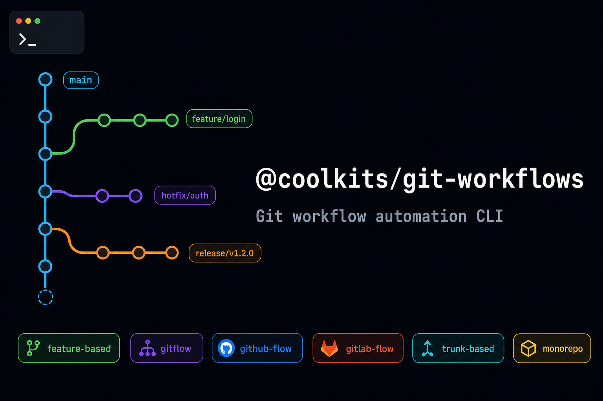

<div align="center">



[](https://www.npmjs.com/package/@coolkits/git-workflows)
[](https://www.npmjs.com/package/@coolkits/git-workflows)
[](https://nodejs.org)
[](./LICENSE)
[](https://github.com/coolkits-teams/coolkits-git-workflows)

**Git workflow automation CLI for modern development teams.**  
One command for every painful git situation — from daily flow automation to emergency rescues.

</div>

---

## ✨ What it does

`@coolkits/git-workflows` gives your team **two layers of commands**:

| Layer                         | Purpose                                                                                                                       |
| ----------------------------- | ----------------------------------------------------------------------------------------------------------------------------- |
| 🏗️ **Architecture workflows** | Automate branch strategies — `feature-based`, `gitflow`, `github-flow`, `gitlab-flow`, `trunk-based`, `monorepo`              |
| 🛠️ **Git utilities**          | One-liner commands for everyday pain points: undo, squash, amend, cherry-pick, branch recovery, conflict resolution, and more |

---

## 📦 Installation

### Option A — Vendored (recommended for teams with supply-chain concerns)

```bash
# In your project (no npm publish needed)
node packages/git-workflows/dist/bin/<command>.js
# or via yarn scripts (see setup below)
```

### Option B — npm

```bash
npm install --save-dev @coolkits/git-workflows
# or
yarn add -D @coolkits/git-workflows
```

---

## 🚀 Quick Setup (Vendored)

**3 steps — takes under 2 minutes.**

**Step 1.** Copy the `dist/` folder into your project:

```
your-project/
└── packages/
    └── git-workflows/
        └── dist/          ← copy here from git-controls/dist/
```

**Step 2.** Add scripts to your `package.json`:

```json
{
  "scripts": {
    "git:extract-common": "node packages/git-workflows/dist/bin/extract-common.js",
    "git:sync-from-root": "node packages/git-workflows/dist/bin/sync-from-root.js",
    "git:create-mr": "node packages/git-workflows/dist/bin/create-mr.js",
    "git:start-branch": "node packages/git-workflows/dist/bin/start-branch.js",
    "git:finish-branch": "node packages/git-workflows/dist/bin/finish-branch.js",
    "git:undo": "node packages/git-workflows/dist/bin/undo.js",
    "git:amend": "node packages/git-workflows/dist/bin/amend.js",
    "git:squash": "node packages/git-workflows/dist/bin/squash.js",
    "git:revert-commit": "node packages/git-workflows/dist/bin/revert-commit.js",
    "git:move-commits": "node packages/git-workflows/dist/bin/move-commits.js",
    "git:cherry-pick": "node packages/git-workflows/dist/bin/cherry-pick.js",
    "git:delete-branch": "node packages/git-workflows/dist/bin/delete-branch.js",
    "git:recover-branch": "node packages/git-workflows/dist/bin/recover-branch.js",
    "git:prune-branches": "node packages/git-workflows/dist/bin/prune-branches.js",
    "git:abort": "node packages/git-workflows/dist/bin/abort.js",
    "git:resolve": "node packages/git-workflows/dist/bin/resolve.js",
    "git:pull-rebase": "node packages/git-workflows/dist/bin/pull-rebase.js",
    "git:purge-file": "node packages/git-workflows/dist/bin/purge-file.js",
    "git:search-commits": "node packages/git-workflows/dist/bin/search-commits.js",
    "git:bisect": "node packages/git-workflows/dist/bin/bisect.js",
    "git:tag-create": "node packages/git-workflows/dist/bin/tag-create.js",
    "git:tag-delete": "node packages/git-workflows/dist/bin/tag-delete.js"
  }
}
```

**Step 3.** Add a config file to your project root (optional — sane defaults apply):

```bash
cp node_modules/@coolkits/git-workflows/git-controls.config.example.json git-controls.config.json
# Edit to match your branch names
```

---

## 🏗️ Architecture Workflows

Select your workflow with `"architecture"` in `git-controls.config.json`.

### `feature-based` (default)

Separates common/shared code changes from feature changes across branches.

```bash
yarn git:extract-common        # Extract shared changes → common/* branch → MR to root
yarn git:sync-from-root        # Pull root changes into your feature branch
yarn git:create-mr             # Open MR: feature → dev (for CI build)
yarn git:start-branch user-auth        # Create feature/user-auth from dev
yarn git:finish-branch                 # Push + MR → dev
```

### `gitflow`

Classic gitflow with `develop`, `release/*`, `hotfix/*`.

```bash
yarn git:start-branch user-auth --type feature    # feature/user-auth from develop
yarn git:start-branch 1.2.0 --type release        # release/1.2.0 from develop
yarn git:start-branch urgent-fix --type hotfix    # hotfix/urgent-fix from main
yarn git:finish-branch                            # MR → develop (feature) / main (release/hotfix)
```

### Other architectures

| Preset        | Default target for MR | Typical flow                           |
| ------------- | --------------------- | -------------------------------------- |
| `github-flow` | `main`                | feature → PR → main                    |
| `gitlab-flow` | `main` → env branches | feature → main → staging → production  |
| `trunk-based` | `main`                | short-lived feature → quick MR to main |
| `monorepo`    | `main`                | scoped `feature/pkg-name` → main       |

### `git-create-mr` — Universal MR creator

```bash
yarn git:create-mr                                  # current branch → default target
yarn git:create-mr --target main --checkout         # safe MR branch (keeps source clean)
yarn git:create-mr --target staging --checkout --base target  # surface conflicts locally
yarn git:create-mr --source feature/auth --target develop
yarn git:create-mr --dry-run
```

| Flag                    | Description                                                           |
| ----------------------- | --------------------------------------------------------------------- |
| `--source`              | Source branch (default: current)                                      |
| `--target`              | Target branch (default: architecture-aware)                           |
| `--checkout`            | Create a `mr/<slug>-<ts>` branch — keeps your feature branch pristine |
| `--base source\|target` | What the MR branch is based on (default: `source`)                    |
| `--no-push`             | Skip push, just open the MR URL                                       |
| `--dry-run`             | Preview without creating anything                                     |

---

## 🛠️ Git Utilities

Commands for everyday pain points. All work independently of architecture.

### Undo & Revert

| Command                         | What it does                                                       |
| ------------------------------- | ------------------------------------------------------------------ |
| `yarn git:undo`                 | Undo last N **unpushed** commits (keeps changes staged by default) |
| `yarn git:undo --hard`          | Undo last N commits AND discard all changes                        |
| `yarn git:revert-commit <hash>` | Safely revert a **pushed** commit (creates a new revert commit)    |

```bash
yarn git:undo --count 2           # undo 2 commits, keep changes
yarn git:revert-commit abc1234    # safe for shared branches
```

### Fix Last Commit

| Command                                | What it does                        |
| -------------------------------------- | ----------------------------------- |
| `yarn git:amend --message "fix: typo"` | Change last commit message          |
| `yarn git:amend --add src/file.ts`     | Add a forgotten file to last commit |
| `yarn git:amend --remove .env`         | Remove a file from last commit      |
| `yarn git:amend --force`               | Amend + force-push (warns team)     |
| `yarn git:squash --count 3`            | Squash last 3 commits into one      |

### Move & Copy Commits

| Command                                             | What it does                                |
| --------------------------------------------------- | ------------------------------------------- |
| `yarn git:move-commits --to feature/correct-branch` | Move last N commits to the right branch     |
| `yarn git:cherry-pick abc1234`                      | Apply a specific commit from another branch |
| `yarn git:cherry-pick abc1234 --range-to def5678`   | Apply a range of commits                    |

```bash
yarn git:move-commits --to feature/auth --count 3   # "I committed to main by mistake"
yarn git:cherry-pick abc1234 --no-commit             # apply but don't commit yet
```

### Branch Management

| Command                                   | What it does                                    |
| ----------------------------------------- | ----------------------------------------------- |
| `yarn git:delete-branch feature/done`     | Delete branch **local + remote** in one command |
| `yarn git:recover-branch feature/deleted` | Recover a recently deleted branch from reflog   |
| `yarn git:prune-branches`                 | Remove all local branches whose remote is gone  |
| `yarn git:prune-branches --dry-run`       | Preview what would be deleted                   |

### Conflict Resolution

| Command                     | What it does                                          |
| --------------------------- | ----------------------------------------------------- |
| `yarn git:abort`            | Auto-detect and abort stuck merge/rebase/cherry-pick  |
| `yarn git:resolve --theirs` | Resolve all conflicts by accepting incoming changes   |
| `yarn git:resolve --ours`   | Resolve all conflicts by keeping local changes        |
| `yarn git:pull-rebase`      | `git pull --rebase` — no merge commit, linear history |

### History & Investigation

| Command                                       | What it does                                                              |
| --------------------------------------------- | ------------------------------------------------------------------------- |
| `yarn git:search-commits --message "feat:"`   | Search commits by message                                                 |
| `yarn git:search-commits --content "API_KEY"` | Search commits that changed a string (useful for finding secret exposure) |
| `yarn git:bisect start --good <hash>`         | Start guided binary search to find a bug-introducing commit               |
| `yarn git:bisect good\|bad`                   | Mark current commit during bisect                                         |
| `yarn git:bisect reset`                       | Abort bisect and return to your branch                                    |

### Sensitive File Removal

```bash
# Always preview first!
yarn git:purge-file .env --dry-run
yarn git:purge-file .env

# After running, force-push all branches + notify team to re-clone
git push origin --force --all
```

> ⚠️ This rewrites ALL git history. If a secret was exposed, **rotate it immediately** regardless.

### Tags

| Command                                         | What it does                          |
| ----------------------------------------------- | ------------------------------------- |
| `yarn git:tag-create v1.2.0`                    | Create annotated tag + push to remote |
| `yarn git:tag-create v1.2.0 --message "Stable"` | Tag with custom message               |
| `yarn git:tag-delete v1.2.0`                    | Delete tag **local + remote**         |

---

## ⚙️ Configuration

Create `git-controls.config.json` in your project root:

```json
{
  "architecture": "feature-based",
  "rootBranch": "root",
  "devBranch": "dev",
  "remote": "origin",
  "featurePath": ["src/features"],
  "mergeRequestProvider": "gitlab"
}
```

Config files per architecture are available in the source repository under [`config-examples/`](https://github.com/coolkits-teams/coolkits-git-workflows/tree/master/config-examples).

| Field                  | Default         | Description                                               |
| ---------------------- | --------------- | --------------------------------------------------------- |
| `architecture`         | `feature-based` | Workflow preset — drives all branch defaults              |
| `mainBranch`           | `main`          | Canonical production branch                               |
| `developBranch`        | `develop`       | Integration branch (gitflow)                              |
| `rootBranch`           | `root`          | Common-source branch (feature-based)                      |
| `devBranch`            | `dev`           | Dev-build integration (feature-based)                     |
| `stagingBranch`        | `staging`       | Staging env (gitlab-flow)                                 |
| `productionBranch`     | `production`    | Production env (gitlab-flow)                              |
| `featureBranchPrefix`  | `feature`       | Prefix for feature branches                               |
| `releaseBranchPrefix`  | `release`       | Prefix for release branches (gitflow)                     |
| `hotfixBranchPrefix`   | `hotfix`        | Prefix for hotfix branches (gitflow)                      |
| `mrBranchPrefix`       | `mr`            | Prefix for safe MR branches (`git-create-mr --checkout`)  |
| `featurePath`          | `src/features`  | Paths treated as feature-specific (feature-based)         |
| `commonExcludePaths`   | `[]`            | Directories excluded from common extract                  |
| `commonExcludeFiles`   | `[]`            | Files excluded from common extract                        |
| `remote`               | `origin`        | Git remote name                                           |
| `protectedBranches`    | `[...]`         | Branches that cannot be used as feature/source            |
| `mergeRequestProvider` | `gitlab`        | `gitlab` (glab CLI), `github` (gh CLI), `none` (URL only) |
| `syncStrategy`         | `merge`         | `merge` or `rebase` for sync-from-root                    |

---

## 🔧 Updating the Vendored Library

```bash
# In the source repo (git-controls/)
npm run verify   # type-check + lint + test + build
# Then copy dist/ to your project's packages/git-workflows/dist/
```

---

## 📄 License

MIT © [David Ngo](https://github.com/davidngo239)

**Repository:** [coolkits-teams/coolkits-git-workflows](https://github.com/coolkits-teams/coolkits-git-workflows/tree/master)
